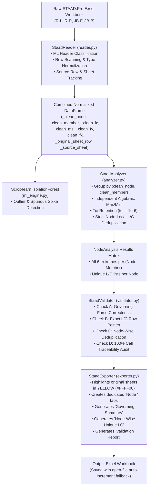
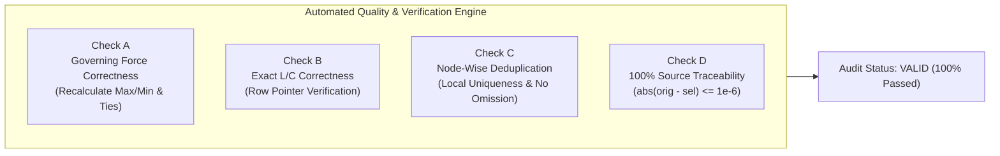

# Complete Engineering Logic, Architecture & Code Guide

This document provides a comprehensive, component-by-component explanation of the **STAAD.Pro Member-Wise Governing Force Extraction & Node-Wise Deduplication System**. It details the mathematical foundations, machine learning components, data extraction pipeline, and Excel workbook generation logic that faithfully reproduces the manual engineering workflow demonstrated in [Recording 2026-11-13 162544.mp4](file:///d:/Automation/Recording%202026-11-13%20162544.mp4).

---

## Table of Contents
1. [Engineering Problem & Core Objectives](#1-engineering-problem--core-objectives)
2. [End-to-End Extraction Pipeline Architecture](#2-end-to-end-extraction-pipeline-architecture)
3. [Deep-Dive Module Breakdown](#3-deep-dive-module-breakdown)
   - [3.1 Configuration & Visual Palette (config.py)](#31-configuration--visual-palette-configpy)
   - [3.2 Hybrid AI/ML Layer (ml_engine.py)](#32-hybrid-aiml-layer-ml_enginepy)
   - [3.3 Robust Excel Ingestion & Source Tracking (reader.py)](#33-robust-excel-ingestion--source-tracking-readerpy)
   - [3.4 Deterministic Governing Force Engine (analyzer.py)](#34-deterministic-governing-force-engine-analyzerpy)
   - [3.5 Excel Generation & Yellow Row Highlighting (exporter.py)](#35-excel-generation--yellow-row-highlighting-exporterpy)
   - [3.6 Automated Verification & Traceability Audit (validator.py)](#36-automated-verification--traceability-audit-validatorpy)
   - [3.7 Desktop GUI & Interactive Mapping Review (main_window.py)](#37-desktop-gui--interactive-mapping-review-main_windowpy)
4. [Step-by-Step Data Walkthrough: Node 136 & Member 2028](#4-step-by-step-data-walkthrough-node-136--member-2028)
5. [How Key Errors Were Solved](#5-how-key-errors-were-solved)
6. [Verification, Testing & Execution Commands](#6-verification-testing--execution-commands)

---

## 1. Engineering Problem & Core Objectives

In structural steel connection design (e.g. beam-to-column or beam-to-jack-beam joints), STAAD.Pro analysis yields thousands of member end force records across dozens or hundreds of load combinations (L/Cs). Members framing into joints are grouped into distinct physical categories exported into separate worksheets:
- **`R-L`**: Rafter - Left
- **`R-R`**: Rafter - Right
- **`JB-F`**: Jack Beam - Front
- **`JB-B`**: Jack Beam - Back

### The Manual Process Shown in the Screen Recording
To design connection joints (such as **Node 136**), a structural engineer manually:
1. Opens the export workbook (`C5 01 - Excel`) and navigates to a member group (e.g. `R-L`).
2. Applies AutoFilter on the `Node` column, filtering for **`136`** (isolating connected member **`2028`**).
3. Opens the filter on **`Moment-Z`**, inspects the extreme values (Min: **`-919.990 kN-m`**, Max: **`+1526.629 kN-m`**), and filters for them.
4. Inspects **`Shear-Y`** (Min: **`-146.266 kN`**, Max: **`+230.941 kN`**), noting they occur under the exact same load cases (**L/C `1005`** and **L/C `1257`**).
5. Inspects **`Axial Force`** (Max: **`+16.094 kN`** at **L/C `1030`**, Min: **`-72.126 kN`** at **L/C `1115`**).
6. Highlights the resulting **4 governing rows** in **Bright Yellow (`#FFFF00`)**.
7. Creates a dedicated sheet for that joint (**`Node 136`**) gathering governing rows across all connected framing members (`2028`, `2502`, `2077`, `2018`).

### Critical System Requirements
1. **Zero ML Prediction for Numbers**: Engineering forces must be 100% deterministic mathematical calculations directly from the STAAD.Pro cells. Machine learning is restricted strictly to semantic header recognition, confidence scoring, and statistical anomaly detection.
2. **Member-Wise Grouping**: Calculations must group by `(Node ID, Member ID)`. A common node must never mix forces across different connected beams.
3. **Preserve Algebraic Signs**: Maximum means $\max(x)$ and minimum means $\min(x)$ on the real number line. Absolute values ($|x|$) are strictly prohibited.
4. **Tie Retention**: If two or more load cases produce the exact same numerical extreme, all corresponding source rows must be retained.
5. **Exact L/C Extraction**: The load case must be retrieved from the exact matching row in that specific source worksheet.
6. **Local Node Deduplication**: Governing L/Cs from all members framing into a node are combined and deduplicated strictly within that node. Common L/Cs across different nodes must never be eliminated.

---

## 2. End-to-End Extraction Pipeline Architecture



---

## 3. Deep-Dive Module Breakdown

### 3.1 Configuration & Visual Palette ([config.py](file:///d:/Automation/staad_processor/config.py))
`config.py` defines the global structural categories, sheet titles, column alias vocabularies, and Excel styling themes:

- **Target Worksheets**: `["R-L", "R-R", "JB-F", "JB-B"]`.
- **Force Components**:
  - `Moment-Z (kN-m)` ($M_z$): Major axis bending moment.
  - `Shear-Y (kN)` ($F_y$): Transverse vertical shear.
  - `Axial Force (kN)` ($F_x$): Direct tension ($+$) or compression ($-$).
- **Visual Palette**:
  - `YELLOW_FILL` (`#FFFF00`): Bright yellow fill replicating the exact row highlights in the user's screen recording.
  - `MAX_FILL` (`#C6EFCE`): Soft green fill for maximum extreme values.
  - `MIN_FILL` (`#FFC7CE`): Soft red fill for minimum extreme values.
  - `BOTH_FILL` (`#FFF2CC`): Soft yellow fill when a single row governs for both extremes.
  - `HEADER_FILL` (`#1F4E79`): Navy blue fill with white bold text for table headers.
  - `NODE_BANNER_FILL` (`#D9E1F2`): Light ice blue banner for node summary blocks.

---

### 3.2 Hybrid AI/ML Layer ([ml_engine.py](file:///d:/Automation/staad_processor/ml_engine.py))

The machine learning layer performs intelligent data understanding without ever touching or modifying numeric structural values:

1. **Scikit-learn TF-IDF Semantic Column Classifier (`MLColumnClassifier`)**:
   - Utilizes character n-gram analysis (`ngram_range=(2, 5)`) with sublinear TF scaling.
   - Computes cosine similarity between tokenized header strings and pre-trained structural engineering centroid representations.
   - **Engineering Safeguards**:
     - Hard boundary checks prevent axis confusion: $M_y$ (weak axis) is never confused with $M_z$ (strong axis); $F_z$ is never confused with $F_y$.
     - Rejects non-force headers (e.g. `Torsion`, `Dist`, `Section`).
   - Computes a continuous confidence score from $0.00$ to $1.00$ ($0\%$ to $100\%$) and provides an explanatory basis (e.g. `Direct Structural Keyword / Axis Token Match`).

2. **Scikit-learn IsolationForest Anomaly Detector (`MLAnomalyDetector`)**:
   - Fits an ensemble of 100 isolation trees (`contamination=0.01`) on force components.
   - Detects severe structural anomalies, accidental text artifacts, or unit conversion discrepancies (e.g. forces in $\text{N}$ instead of $\text{kN}$).

3. **Continuous Active Feedback Store (`MLLearningStore`)**:
   - Persists confirmed user mappings to `learning_store.json`.
   - When a user confirms a header in the GUI, it is assigned a boosted confidence ($1.00$), enabling the software to learn custom firm-specific STAAD naming styles permanently.

---

### 3.3 Robust Excel Ingestion & Source Tracking ([reader.py](file:///d:/Automation/staad_processor/reader.py))

`reader.py` ingests multi-sheet workbooks and normalizes them into structured DataFrames:

1. **Dynamic Header Row Scanning (`find_header_row_ml`)**:
   - Scans up to 30 rows from the top of each worksheet.
   - Evaluates both **single-line headers** and **two-line merged headers** (combining row $r$ and row $r+1$).
   - A row is declared a valid header only if both `Node` and `Member` are recognized with high confidence ($\ge 4.0$ weighted score).

2. **Data Normalization Functions**:
   - `clean_numeric_value(val)`: Safely handles strings with thousands separators (`"1,526.629"`), Unicode minus signs (`"−"`, `"\u2212"`), whitespace, and empty cells (`"-"`, `"N/A"`).
   - `clean_id_value(val)`: Normalizes node and member IDs (`136.0` $\rightarrow$ `"136"`), ensuring integer IDs match regardless of whether Excel formatted them as text, float, or integer.

3. **Source Coordinate Pointers**:
   - Injects `_source_sheet` (e.g. `"R-L"`) and `_original_sheet_row` (1-based physical row index in the raw Excel sheet) into every row.
   - These pointers guarantee 100% auditability and enable direct cell-level traceability.

---

### 3.4 Deterministic Governing Force Engine ([analyzer.py](file:///d:/Automation/staad_processor/analyzer.py))

`analyzer.py` contains the core structural engineering selection logic:

#### A. Member-Wise Isolation
```python
# Group records strictly by Node ID and Member ID
group_keys = self.combined_df.groupby(['clean_node', 'clean_member'], sort=True).groups
```
Each member connected to a node is analyzed separately. For example, at Node 136, Member 2028 is evaluated completely independently from Member 2502.

#### B. Independent Algebraic Extremes
For each `(Node, Member)` subset, algebraic extremes are calculated across all available load cases:
$$\text{Max Force} = \max(x_1, x_2, \dots, x_n)$$
$$\text{Min Force} = \min(x_1, x_2, \dots, x_n)$$

- Positive and negative signs are preserved.
- Absolute values are **never** used.

#### C. Floating-Point Tie Retention ($\pm 10^{-6}$)
If multiple load cases yield identical extreme values, every matching row is retained:
```python
max_matches = sub_df[np.isclose(series, max_val, atol=1e-6, rtol=1e-6)]
min_matches = sub_df[np.isclose(series, min_val, atol=1e-6, rtol=1e-6)]
```
Each match is recorded as a `GoverningRecord` containing the exact `lc`, `source_sheet`, and `source_row`.

#### D. Local Node Deduplication
After member-wise calculations are complete, the governing L/Cs from all connected members meeting at the joint are combined and deduplicated strictly within that node:
```python
# Deduplicate within this Node ID only, preserving discovery order
unique_lcs = []
seen = set()
for lc in node_governing_lcs:
    clean_lc = clean_id_value(lc)
    if clean_lc not in seen:
        seen.add(clean_lc)
        unique_lcs.append(clean_lc)

self.node_unique_lcs[node_id] = unique_lcs
```
**Cross-Node Rule**: If L/C 1005 governs at Node 136 and also at Node 149, it appears independently in both lists.

---

### 3.5 Excel Generation & Yellow Row Highlighting ([exporter.py](file:///d:/Automation/staad_processor/exporter.py))

`exporter.py` generates the output workbook matching the screen recording workflow:

1. **Source Workbook Preservation**:
   - If an input workbook path is provided, `exporter.py` loads the original workbook with `openpyxl.load_workbook(input_file_path)`.
   - All original worksheets (`R-L`, `R-R`, `JB-F`, `JB-B`), column widths, formulas, and formatting are preserved.

2. **Yellow Row Highlighting in Source Sheets (`_highlight_governing_rows_in_source_sheets`)**:
   - Collects all governing source row coordinates: `(source_sheet, source_row)`.
   - Iterates through the source sheets and applies `YELLOW_FILL` (`#FFFF00`) across all columns of every governing row:
   ```python
   for ws in self.wb.worksheets:
       # Match sheet name and target rows
       for r_idx in target_rows:
           for c_idx in range(1, max_col + 1):
               cell = ws.cell(row=r_idx, column=c_idx)
               cell.fill = YELLOW_FILL
   ```

3. **Dedicated Per-Node Worksheets (`_build_node_tabs`)**:
   - Creates a worksheet for every unique node: `Node <ID>` (e.g. `Node 136`, `Node 149`).
   - **Header Block**: Lists connected members and unique governing L/Cs.
   - **Governing Table**: Gathers the complete original rows from `R-L`, `R-R`, `JB-F`, `JB-B` for all members framing into that node.
   - Highlights the rows in **Yellow (`#FFFF00`)**.
   - Adds a `Governing Reasons` column explicitly describing the extreme (e.g. `Moment-Z (MAX: 1526.629); Shear-Y (MAX: 230.941)`).

4. **Master Summary & Audit Tabs**:
   - **`Governing Summary`**: Consolidated table listing each extreme, corresponding L/C, source sheet, and row.
   - **`Node-Wise Unique LC`**: Joint summary table and itemized unique L/C list.
   - **`Validation Report`**: Executive metrics, checks A–D, and full traceability audit.

5. **Locked File Auto-Fallback**:
   - If Microsoft Excel has the target output file open, catching `PermissionError` automatically diverts the save to an auto-incremented file (`[name]_1.xlsx`), preventing crashes and data loss.

---

### 3.6 Automated Verification & Traceability Audit ([validator.py](file:///d:/Automation/staad_processor/validator.py))

`validator.py` executes four mandatory engineering checks before certifying the output:



- **Check A**: Recalculates numerical $\max(x)$ and $\min(x)$ independently for every `(Node, Member, Force)` combination. Verifies value matches and tie counts match.
- **Check B**: Verifies that the assigned L/C belongs to the exact physical source row index.
- **Check C**: Verifies that no duplicate L/Cs exist within any node, no governing L/C was dropped, and identical L/Cs appear independently across different nodes.
- **Check D**: Cross-checks every extracted governing record against the raw Excel cell value in `combined_df`. If $|V_{\text{original}} - V_{\text{selected}}| \le 10^{-6}$, it marks the row **VALID**.

---

### 3.7 Desktop GUI & Interactive Mapping Review ([main_window.py](file:///d:/Automation/gui/main_window.py))

`main_window.py` provides an intuitive desktop interface built with Tkinter:
- **Asynchronous Execution**: Pipeline runs in a daemon `threading.Thread`, keeping the UI responsive and displaying real-time progress percentages.
- **🔍 Preview AI Mappings Dialog**:
  - Displays detected worksheets and mapped columns in a tabbed `ttk.Notebook` with `ttk.Treeview`.
  - Shows ML confidence percentages and detection bases.
  - Allows engineers to click **"✔ Confirm Mappings & Save to AI Memory"**, storing verified mappings to `learning_store.json`.
- **Proactive File Lock Detection**: Tests write permissions before starting and prompts the user to auto-increment if the target file is open in Microsoft Excel.
- **One-Click Action Buttons**: "📄 Open Generated Excel" and "📁 Open Folder" to review results immediately upon completion.

---

## 4. Step-by-Step Data Walkthrough: Node 136 & Member 2028

Here is the exact data progression for the benchmark joint demonstrated in the screen recording:

### Input Source Data in `R-L` (Filtered for Node 136, Member 2028):
```text
Row 12:  Beam 2028 | L/C 1005 | Node 136 | Axial -59.469 | Shear-Y -146.266 | Moment-Z -919.990
Row 62:  Beam 2028 | L/C 1030 | Node 136 | Axial +16.094 | Shear-Y  +79.836 | Moment-Z +548.898
Row 232: Beam 2028 | L/C 1115 | Node 136 | Axial -72.126 | Shear-Y  +13.049 | Moment-Z  +96.224
Row 516: Beam 2028 | L/C 1257 | Node 136 | Axial  -4.841 | Shear-Y +230.941 | Moment-Z +1526.629
```

### Analysis & Governing Identification:
1. **Moment-Z ($M_z$)**:
   - Maximum: **`+1526.629 kN-m`** $\rightarrow$ Row 516, **L/C `1257`**
   - Minimum: **`-919.990 kN-m`** $\rightarrow$ Row 12, **L/C `1005`**
2. **Shear-Y ($F_y$)**:
   - Maximum: **`+230.941 kN`** $\rightarrow$ Row 516, **L/C `1257`** (concurrent with Max $M_z$)
   - Minimum: **`-146.266 kN`** $\rightarrow$ Row 12, **L/C `1005`** (concurrent with Min $M_z$)
3. **Axial Force ($F_x$)**:
   - Maximum: **`+16.094 kN`** $\rightarrow$ Row 62, **L/C `1030`**
   - Minimum: **`-72.126 kN`** $\rightarrow$ Row 232, **L/C `1115`**

### Output in Worksheet `R-L`:
Rows 12, 62, 232, and 516 are filled with **Bright Yellow (`#FFFF00`)** across Columns A to I.

### Output in Worksheet `Node 136`:
The tab gathers these 4 rows plus the governing rows from framing members `2502` (`R-R`), `2077` (`JB-F`), and `2018` (`JB-B`), all highlighted in Yellow with their Governing Reasons.

---

## 5. How Key Errors Were Solved

| Issue | Previous Naive Implementation | Corrected Engineering Solution |
| :--- | :--- | :--- |
| **Incorrect L/C Selection** | Grouped by `Node` only; assigned L/C of Member A to Member B. Used `.iloc[0]` or `.abs().max()`. | Grouped strictly by `(Node ID, Member ID)`. Uses algebraic $\max(x)$ and $\min(x)$. Retains all tied source rows within $\pm 10^{-6}$. |
| **Incorrect Deduplication** | Global deduplication across all nodes stripped valid load cases from downstream nodes. | Deduplication is strictly isolated within each Node ID boundary. |
| **Output Sheet Layout** | Generated a generic table that did not match the user's manual workflow. | Highlights governing rows in Yellow in the original sheets and creates dedicated `Node <ID>` tabs for every joint. |
| **Windows Excel File Lock** | Crashed with `PermissionError: [Errno 13]` when output file was open in Excel. | Proactively tests file lock and auto-diverts to auto-incremented filename (`_1.xlsx`). |
| **Tkinter Asynchronous NameError** | `lambda: self._on_processing_error(str(e))` failed because Python cleared `e` upon exiting the `except` block. | Binds the error string to default lambda argument: `lambda msg=err_msg: self._on_processing_error(msg)`. |

---

## 6. Verification, Testing & Execution Commands

### Run Full Automated Test Suite:
```powershell
python -m unittest tests.test_processor -v
```
*(All 9 tests verify column classification, feedback store, 4-sheet ingestion, benchmark values, tie retention, all 5 worksheets + node tabs, GUI closure safety, and locked file auto-fallback).*

### Run via Command-Line Interface (CLI):
```powershell
python main.py path\to\your_staad_file.xlsx -o path\to\output_file.xlsx
```

### Launch Graphical Desktop Application (GUI):
```powershell
python run_app.py
```
*(or `python main.py --gui`)*

