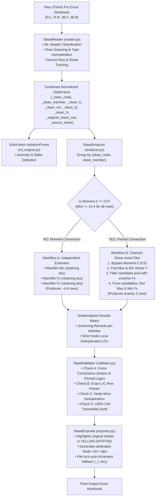

# Complete Engineering Logic, Architecture & Code Guide

This document provides a comprehensive, component-by-component explanation of the **STAAD.Pro Member-Wise Governing Force Extraction & Node-Wise Deduplication System**. It details the mathematical foundations, machine learning components, data extraction pipeline, and Excel workbook generation logic that faithfully reproduces the manual engineering workflows demonstrated in:
1. [Recording 2026-11-13 162544.mp4](file:///d:/Automation/Recording%202026-11-13%20162544.mp4) (Moment Connection Workflow: $M_z \ne 0$)
2. [Screen Recording 2026-11-14 131115.mp4](file:///d:/Automation/Screen%20Recording%202026-11-14%20131115.mp4) (Pinned Connection Workflow: $M_z = 0.0$)

---

## Table of Contents
1. [Engineering Problem & Dual Workflow Objectives](#1-engineering-problem--dual-workflow-objectives)
   - [1.1 Workflow A: Moment Connections (R-L, R-R: Mz ≠ 0)](#11-workflow-a-moment-connections-r-l-r-r-mz--0)
   - [1.2 Workflow B: Pinned / Shear Connections (JB-F, JB-B: Mz = 0.0)](#12-workflow-b-pinned--shear-connections-jb-f-jb-b-mz--00)
2. [End-to-End Extraction Pipeline Architecture](#2-end-to-end-extraction-pipeline-architecture)
3. [Deep-Dive Module Breakdown](#3-deep-dive-module-breakdown)
   - [3.1 Configuration & Visual Palette (config.py)](#31-configuration--visual-palette-configpy)
   - [3.2 Hybrid AI/ML Layer (ml_engine.py)](#32-hybrid-aiml-layer-ml_enginepy)
   - [3.3 Robust Excel Ingestion & Source Tracking (reader.py)](#33-robust-excel-ingestion--source-tracking-readerpy)
   - [3.4 Deterministic Governing Force Engine (analyzer.py)](#34-deterministic-governing-force-engine-analyzerpy)
   - [3.5 Excel Generation & Yellow Row Highlighting (exporter.py)](#35-excel-generation--yellow-row-highlighting-exporterpy)
   - [3.6 Automated Verification & Traceability Audit (validator.py)](#36-automated-verification--traceability-audit-validatorpy)
   - [3.7 Desktop GUI & Interactive Mapping Review (main_window.py)](#37-desktop-gui--interactive-mapping-review-main_windowpy)
   - [3.8 Automated Beam Type & Connection Classification](#38-automated-beam-type--connection-classification)
4. [Step-by-Step Data Walkthroughs](#4-step-by-step-data-walkthroughs)
   - [4.1 Moment Connection Walkthrough: Node 136 & Member 2028 (R-L)](#41-moment-connection-walkthrough-node-136--member-2028-r-l)
   - [4.2 Pinned Connection Walkthrough: Node 1457 & Member 1072 (JB-F)](#42-pinned-connection-walkthrough-node-1457--member-1072-jb-f)
5. [How Key Errors & Edge Cases Were Solved](#5-how-key-errors--edge-cases-were-solved)
6. [Verification, Testing & Execution Commands](#6-verification-testing--execution-commands)

---

## 1. Engineering Problem & Dual Workflow Objectives

In structural steel connection design (e.g. beam-to-column or beam-to-jack-beam joints), STAAD.Pro analysis yields thousands of member end force records across dozens or hundreds of load combinations (L/Cs). Members framing into joints are grouped into physical categories exported into separate worksheets. Across different engineering models, sheet names vary:
- **`R-L` / `R-R`**: Rafter - Left / Right (Typically Moment Connections)
- **`JB-F` / `JB-B`**: Jack Beam - Front / Back (Typically Pinned / Shear Connections)
- **`JB`**: Jack Beam (Single worksheet model replacing separate Front/Back sheets)
- **`TB`**: Tie Beam (Typically Pinned / Axial-dominated Connections)

The software automatically discovers whatever member force sheets exist in the workbook—whether `["R-L", "R-R", "JB-F", "JB-B"]`, `["R-L", "R-R", "JB", "TB"]`, or any combination—without requiring manual configuration.

Structural connections behave differently based on whether they transfer bending moments:

### 1.1 Workflow A: Moment Connections (`R-L`, `R-R`: $M_z \ne 0$)
*Demonstrated in [Recording 2026-11-13 162544.mp4](file:///d:/Automation/Recording%202026-11-13%20162544.mp4)*

For moment-resisting members, bending is the primary design driver:
1. The engineer navigates to the worksheet (e.g. `R-L`) and filters by **`Node`** (e.g. `136`).
2. Checks **`Moment-Z (kN-m)`**: values are non-zero.
3. Filters for numerical **Maximum** (+1526.629 kN-m) and **Minimum** (-919.990 kN-m).
4. Evaluates concurrent **`Shear-Y (kN)`** (Max: +230.941 kN, Min: -146.266 kN).
5. Filters for **`Axial Force (kN)`** (Max: +16.094 kN, Min: -72.126 kN).
6. Highlights the resulting **4 governing rows** in **Bright Yellow (`#FFFF00`)**.
7. Creates a dedicated joint tab (**`Node 136`**) compiling governing rows from all framing members.

---

### 1.2 Workflow B: Pinned / Shear Connections (`JB-F`, `JB-B`: $M_z = 0.0$)
*Demonstrated in [Screen Recording 2026-11-14 131115.mp4](file:///d:/Automation/Screen%20Recording%202026-11-14%20131115.mp4)*

For pinned members (such as Jack Beams or simply supported purlins), bending moment is released ($M_z = 0.000$ across all load cases). 
> [!IMPORTANT]
> If $M_z = 0.0$ is evaluated naively, every single row is a "tie" with 0.0, causing hundreds of rows to be falsely highlighted!
> In actual engineering practice, the engineer switches to **chained shear-axial filtering**:

1. The engineer navigates to the worksheet (e.g. `JB-F`) and filters by **`Node`** (e.g. `1457`, Member `1072`).
2. Checks **`Moment-Z (kN-m)`**: all values are `0.000` (pinned connection).
3. Moves to **`Shear-Y (kN)`**:
   - Opens AutoFilter dropdown showing distinct shear values (e.g. `0.146`, `0.195`, `0.243`).
   - Unselects intermediate values and checks **ONLY** the **Minimum** (`0.146`) and **Maximum** (`0.243`).
   - The table narrows down to the subset of rows with extreme shear (165 records found).
4. Moves to **`Axial Force (kN)`** (while Shear-Y filter is active):
   - Opens AutoFilter dropdown displaying axial values among the filtered shear rows.
   - Checks **ONLY** the **Minimum** (`-43.702`) and **Maximum** (`49.004`).
   - The table narrows down to **EXACTLY 2 ROWS**:
     - **Row 18**: L/C `1008` | Shear-Y = `0.146` (Min) | Axial Force = `49.004` (Max)
     - **Row 220**: L/C `1109` | Shear-Y = `0.243` (Max) | Axial Force = `-43.702` (Min)
5. Highlights both rows across Columns A to I in **Bright Yellow (`#FFFF00`)**.
6. Compiles these governing rows into the dedicated **`Node 1457`** joint tab.

---

## 2. End-to-End Extraction Pipeline Architecture



---

## 3. Deep-Dive Module Breakdown

### 3.1 Configuration & Visual Palette ([config.py](file:///d:/Automation/staad_processor/config.py))
`config.py` defines the global structural categories, sheet titles, column alias vocabularies, and Excel styling themes:
- **Target Worksheets**: `["R-L", "R-R", "JB-F", "JB-B"]`.
- **Visual Palette**:
  - `YELLOW_FILL` (`#FFFF00`): Bright yellow fill replicating the exact row highlights in the user's screen recordings.
  - `HEADER_FILL` (`#1F4E79`): Navy blue fill with white bold text for table headers.
  - `NODE_BANNER_FILL` (`#D9E1F2`): Light ice blue banner for node summary blocks.

---

### 3.2 Hybrid AI/ML Layer ([ml_engine.py](file:///d:/Automation/staad_processor/ml_engine.py))
The machine learning layer performs intelligent data understanding without ever modifying numeric structural values:
1. **Scikit-learn TF-IDF Semantic Column Classifier (`MLColumnClassifier`)**:
   - Utilizes character n-gram analysis (`ngram_range=(2, 5)`) with sublinear TF scaling.
   - Computes cosine similarity between tokenized header strings and pre-trained structural engineering centroid representations.
   - Hard boundary checks prevent axis confusion ($M_y$ vs $M_z$, $F_z$ vs $F_y$) and reject non-force headers (`Torsion`, `Dist`).
2. **Scikit-learn IsolationForest Anomaly Detector (`MLAnomalyDetector`)**:
   - Fits an ensemble of 100 isolation trees (`contamination=0.01`) on force components to flag spurious text entries or unit mismatches.
3. **Continuous Active Feedback Store (`MLLearningStore`)**:
   - Persists confirmed user mappings to `learning_store.json` so custom naming conventions are remembered permanently.

---

### 3.3 Robust Excel Ingestion & Dynamic Sheet Discovery ([reader.py](file:///d:/Automation/staad_processor/reader.py))
- **Dynamic Worksheet Auto-Discovery**:
  - Automatically inspects every worksheet in the input workbook.
  - Recognizes standard structural sheet naming patterns: `R-L`, `R-R`, `JB-F`, `JB-B`, `JB`, `TB`, `TB-F`, `TB-B`, `R`, `Rafter`, `Tie`, `Jack Beam`.
  - Verifies presence of STAAD member tables (`Node` and `Member`/`Beam` headers) using character n-gram TF-IDF scanning.
  - Non-data worksheets (e.g. `Notes`, `Cover`, `Summary`) are safely bypassed.
  - Seamlessly supports models with separate `JB-F` / `JB-B` as well as models with unified `JB` and `TB`.
- **Dynamic Header Row Scanning**: Scans up to 30 rows, checking both single-line and two-line merged headers.
- **Data Normalization**: Handles thousands separators (`"1,526.629"`), Unicode minus signs (`"−"`), whitespace, and empty cells.
- **Source Coordinate Pointers**: Injects `_source_sheet` (e.g. `"JB"`, `"TB"`, `"JB-F"`) and `_original_sheet_row` (1-based physical row in Excel) into every record for 100% cell traceability.

---

### 3.4 Deterministic Governing Force Engine ([analyzer.py](file:///d:/Automation/staad_processor/analyzer.py))

`analyzer.py` automatically distinguishes between Moment and Pinned connections:

```python
# 1. Detect if member is zero-moment (pinned connection)
is_zero_moment = True
if "_clean_moment_z" in m_sub.columns:
    valid_mz = m_sub[m_sub["_clean_moment_z"].notna()]["_clean_moment_z"].astype(float)
    if not valid_mz.empty:
        if abs(float(valid_mz.max())) > 1e-4 or abs(float(valid_mz.min())) > 1e-4:
            is_zero_moment = False

# 2. Branch processing
if is_zero_moment:
    m_recs = self._find_zero_moment_extremes(m_sub, m_gov, node_id, m_id, source_sheet)
else:
    # Evaluate Mz, Fy, Fx independently
    ...
```

#### The `_find_zero_moment_extremes` Algorithm:
1. **Bypass Moment-Z**: No records generated for $M_z = 0.0$.
2. **Find Shear-Y Extremes**:
   $$F_{y,\max} = \max(\text{Shear-Y}), \quad F_{y,\min} = \min(\text{Shear-Y})$$
3. **Build Candidate Pool**:
   $$S = \{ r \mid |F_y(r) - F_{y,\max}| \le 10^{-6} \text{ or } |F_y(r) - F_{y,\min}| \le 10^{-6} \}$$
4. **Find Axial Extremes within Candidate Pool**:
   $$F_{x,\max}^{\text{cand}} = \max_{r \in S} F_x(r), \quad F_{x,\min}^{\text{cand}} = \min_{r \in S} F_x(r)$$
5. **Select Governing Rows**:
   Select rows in $S$ where $F_x(r) == F_{x,\max}^{\text{cand}}$ or $F_x(r) == F_{x,\min}^{\text{cand}}$.
   Safeguard ensures both $F_{y,\max}$ and $F_{y,\min}$ branches remain represented even in extreme asymmetric distributions.
6. **Result**: Yields **exactly 2 governing rows** (one per shear extreme), matching the user's manual filter clicks.

---

### 3.5 Excel Generation & Yellow Row Highlighting ([exporter.py](file:///d:/Automation/staad_processor/exporter.py))

1. **Yellow Highlighting in Source Worksheets**:
   Applies `YELLOW_FILL` (`#FFFF00`) across all columns of every governing row in `R-L`, `R-R`, `JB-F`, `JB-B`.
2. **Dedicated Joint Tabs (`Node <ID>`)**:
   Generates a worksheet for each joint (e.g. `Node 136`, `Node 1457`) gathering all governing rows for connected members framing into that node, formatted in yellow with clear `Governing Reasons`.
3. **No Unwanted Clutter**:
   Extra summary sheets (`Governing Summary`, `Audit`) are disabled by default (`include_summary_sheets=False`), keeping the workbook clean and identical to the engineer's manual deliverables.
4. **Locked File Auto-Fallback**:
   If Excel has the output file open, catches `PermissionError` and automatically saves to `[name]_1.xlsx`.

---

### 3.6 Automated Verification & Traceability Audit ([validator.py](file:///d:/Automation/staad_processor/validator.py))

Executes four strict quality checks:
- **Check A (Force Correctness)**:
  - For Moment connections: Verifies algebraic Max & Min match raw data with all ties retained.
  - For Pinned connections: Verifies $M_z = 0.000$ was bypassed, Shear-Y extremes match, and Axial Force extremes match the candidate pool.
- **Check B (Exact Row Pointer)**: Verifies that assigned L/Cs belong to the exact physical source rows.
- **Check C (Node Deduplication)**: Verifies L/C uniqueness within each node without dropping governing cases.
- **Check D (100% Cell Traceability)**: Compares extracted numbers against original cells ($|V_{\text{orig}} - V_{\text{sel}}| \le 10^{-6}$).

---

### 3.7 Desktop GUI ([main_window.py](file:///d:/Automation/gui/main_window.py))
- Built with Tkinter with background worker threads.
- Proactive file lock detection before execution.
- Optional checkbox `"Generate extra summary sheets (Summary, Audit)"` (defaults to unchecked).
- Action buttons: "Open Generated Excel" and "Open Folder".

---

### 3.8 Automated Beam Type & Connection Classification

To streamline connection design review and eliminate guesswork across complex structural models, the engine automatically identifies:
1. **Beam Type**:
   - `Rafter (Left)` (`R-L`)
   - `Rafter (Right)` (`R-R`)
   - `Jack Beam (Front)` (`JB-F`)
   - `Jack Beam (Back)` (`JB-B`)
   - `Jack Beam` (`JB`)
   - `Tie Beam` (`TB`)
   - `Column` (`Col`, `Column`)
   - `Bracing / Strut` (`Brace`, `Strut`)
   - `Beam` (General framing member)
2. **Connection Type**:
   - `Moment Connection`: Active bending capacity ($|M_z| > 1.0\text{ kN-m}$)
   - `Pinned Connection`: Moment release ($|M_z| \le 10^{-4}\text{ kN-m}$) with high shear transfer
   - `Pinned / Axial Strut`: Moment release with axial-dominated force profile

#### Two-Layer Classification Architecture:
- **Layer 1: Semantic Name & Pattern Recognition**: Parses source sheet tokens, recognizing abbreviations (`R-L`, `R-R`, `JB-F`, `JB-B`, `JB`, `TB`).
- **Layer 2: Physics-Based Force Signature**: Evaluates $|M_z|$ across all load cases. If $|M_z| \le 10^{-4}\text{ kN-m}$, connection is flagged as Pinned, activating Workflow B (chained shear-axial filtering).
- **User Presentation**:
  - Dedicated joint tabs (`Node <ID>`) feature **`Beam Type`** and **`Connection`** columns alongside raw forces and governing reasons.
  - Subtitle banner lists connected framing members with identified beam types: `Connected Framing Members (4): 101 (Rafter (Left)), 102 (Rafter (Right)), 103 (Jack Beam), 104 (Tie Beam)`.
  - Execution log in GUI and CLI displays beam type per member framing into each joint.

---

## 4. Step-by-Step Data Walkthroughs

### 4.1 Moment Connection Walkthrough: Node 136 & Member 2028 (`R-L`)
*From [Recording 2026-11-13 162544.mp4](file:///d:/Automation/Recording%202026-11-13%20162544.mp4)*

```text
Row 12:  Beam 2028 | L/C 1005 | Node 136 | Axial -59.469 | Shear-Y -146.266 | Moment-Z -919.990
Row 62:  Beam 2028 | L/C 1030 | Node 136 | Axial +16.094 | Shear-Y  +79.836 | Moment-Z +548.898
Row 232: Beam 2028 | L/C 1115 | Node 136 | Axial -72.126 | Shear-Y  +13.049 | Moment-Z  +96.224
Row 516: Beam 2028 | L/C 1257 | Node 136 | Axial  -4.841 | Shear-Y +230.941 | Moment-Z +1526.629
```

- **Moment-Z**: Max = `+1526.629` (Row 516, L/C 1257), Min = `-919.990` (Row 12, L/C 1005)
- **Shear-Y**: Max = `+230.941` (Row 516, L/C 1257), Min = `-146.266` (Row 12, L/C 1005)
- **Axial Force**: Max = `+16.094` (Row 62, L/C 1030), Min = `-72.126` (Row 232, L/C 1115)
- **Governing Rows**: Rows 12, 62, 232, 516 (4 rows highlighted Yellow).

---

### 4.2 Pinned Connection Walkthrough: Node 1457 & Member 1072 (`JB-F`)
*From [Screen Recording 2026-11-14 131115.mp4](file:///d:/Automation/Screen%20Recording%202026-11-14%20131115.mp4)*

```text
Total Records for Node 1457: 773 load combinations.
Moment-Z values: All 0.000 kN-m.
Distinct Shear-Y values in AutoFilter: 0.146, 0.195, 0.243.
```

#### Step 1: Filter Shear-Y Extremes
- **Min Shear-Y**: `0.146 kN`
- **Max Shear-Y**: `0.243 kN`
- Checking `0.146` and `0.243` narrows the view to **165 candidate rows**.

#### Step 2: Filter Axial Force Extremes from Candidates
Opening the Axial Force filter on the 165 visible rows reveals:
- **Min Axial Force**: `-43.702 kN` (Row 220, L/C 1109)
- **Max Axial Force**: `+49.004 kN` (Row 18, L/C 1008)

#### Step 3: Resulting Governing Rows (Exactly 2 Rows)
```text
Row 18:  Beam 1072 | L/C 1008 | Node 1457 | Axial +49.004 | Shear-Y 0.146 | Moment-Z 0.000
Row 220: Beam 1072 | L/C 1109 | Node 1457 | Axial -43.702 | Shear-Y 0.243 | Moment-Z 0.000
```
- **Worksheet `JB-F`**: Rows 18 and 220 are highlighted in **Bright Yellow (`#FFFF00`)**.
- **Worksheet `Node 1457`**: Contains Rows 18 and 220 with reasons:
  - Row 18: `Shear-Y (MIN: 0.146); Axial Force (MAX: 49.004)`
  - Row 220: `Shear-Y (MAX: 0.243); Axial Force (MIN: -43.702)`
- **Unique Governing L/Cs**: `["1008", "1109"]`.

---

## 5. How Key Errors & Edge Cases Were Solved

| Issue | Root Cause | Engineering Solution |
| :--- | :--- | :--- |
| **Zero-Moment "Tie Explosion"** | Treating $M_z = 0.0$ as a normal extreme matched every row in the sheet, highlighting hundreds of zero-moment rows. | Added `is_zero_moment` detection ($|M_z| \le 10^{-4}$). Moment-Z is completely bypassed for pinned members. |
| **Pinned Member Selecting Hundreds of Shear Rows** | Previous logic calculated independent extremes for Shear-Y, selecting all 165 rows that had nominal shear `0.146` or `0.243`. | Replaced with chained filtering: finds Shear-Y extremes, forms candidate pool, then filters extreme Axial Force, leaving **exactly 2 rows**. |
| **Validation False Warning on Pinned Members** | `validator.py` expected tie counts for Shear-Y to equal the raw table tie count, which failed when Axial filtering was applied. | Updated Check A to validate chained candidate-pool selection for pinned members, achieving **100% VALID** with 0 warnings. |
| **Dynamic Sheet Variations (`JB`, `TB` vs `JB-B`, `JB-F`)** | Hardcoded sheet expectations ignored workbooks using single `JB` or Tie Beam `TB`, or falsely flagged missing worksheets. | Implemented dynamic member sheet auto-discovery and adaptive validation. Works out-of-the-box for `JB`, `TB`, `JB-F`, `JB-B`, `R-L`, `R-R`, etc. |
| **Unwanted Extra Summary Sheets** | Default exporter created `Governing Summary` and `Validation Report` tabs which crowded the user's Excel tab bar. | Disabled by default (`include_summary_sheets=False`). Only original sheets + `Node <ID>` tabs are generated. |
| **Windows Excel File Lock** | Windows locks open Excel files, causing `PermissionError: [Errno 13]`. | Added pre-flight check in GUI and automatic fallback to `[name]_1.xlsx` in `exporter.py`. |
| **Tkinter Closure NameError** | `lambda: self._on_processing_error(str(e))` failed because Python cleared `e` upon exiting the `except` block. | Bound error string to default argument: `lambda msg=err_msg: self._on_processing_error(msg)`. |

---

## 6. Verification, Testing & Execution Commands

### Run Full Automated Test Suite:
```powershell
python -m unittest tests.test_processor -v
```
*(All 11 unit tests verify column classification, feedback store, 4-sheet ingestion, dynamic JB/TB discovery, benchmark values, tie retention, locked file auto-fallback, and pinned connection chained filtering).*

### Run via Command-Line Interface (CLI):
```powershell
python main.py path\to\your_staad_file.xlsx -o path\to\output_file.xlsx
```

### Launch Desktop Application (GUI):
```powershell
python run_app.py
```
*(or `python main.py --gui`)*
